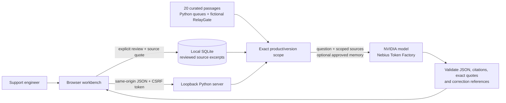

# TraceDesk

**A small technical-support workbench with scoped evidence and human-reviewed memory.** Built for the Nebius × NVIDIA Global AI Hackathon, Best Apps and Agents track.

TraceDesk answers from bounded, versioned technical evidence using an NVIDIA model through Nebius Token Factory. Every supported response must cite valid passage IDs **and exact excerpts** from the selected version's curated passages. It includes a real Python queue-migration case and a separate fictional runbook. An operator can approve an exact source excerpt for future questions; the app keeps it in SQLite. Model weights do not change.

**Current verification boundary:** local storage, validation, HTTP protections, responsive UI, and error paths have been tested. **Live Nebius inference and semantic answer quality have not yet been verified** because an API key is not configured in the build environment. No hosted service, video submission, acceptance receipt, or prize is claimed. The application never substitutes prerecorded answers for failed inference.

## Run locally

Requires Python **3.10+**, with no production dependencies. Open a terminal in this directory:

```bash
python3 -m tracedesk.server
```

Open **http://127.0.0.1:8765**. Source browsing and reviewed-memory save/list/clear work without a provider key. The server intentionally binds only to loopback. On Windows, `py -m tracedesk.server` can replace `python3`.

To enable actual inference without writing a key to disk or command history:

```bash
python3 -m tracedesk.server --prompt-key
```

Enter your Nebius API key at the hidden terminal prompt. It stays in the server environment and is inherited by one short-lived provider worker; it is never placed in command arguments, sent to the browser, or saved to the correction database. Alternatively, set `NEBIUS_API_KEY` in your process environment. The `.env.example` documents variable names; the app does not automatically load `.env` files.

Default model: `nvidia/Nemotron-3_5-Lightning`. Confirm exact current availability in your Nebius account. Set `NEBIUS_MODEL` to another accessible NVIDIA model identifier if needed. The app uses the [official OpenAI-compatible endpoint](https://docs.tokenfactory.nebius.com/quickstart), `https://api.tokenfactory.nebius.com/v1/chat/completions`. JSON-mode support and access need a real request; a configured key alone is not a connectivity pass.

## Try the workflow

1. Open **Version lens** and compare Python queues **3.12 → 3.13**. Read the upstream links and download the source comparison as Markdown. This is a genuine deterministic source workflow with no model call.
2. Choose **Ask about this change** to open a question scoped to the target release. With Nebius configured, ask whether `join()` returning proves every queued job finished. Inspect both the passage ID and exact excerpt. A valid quote is not, by itself, proof the answer entails it.
3. For a separate synthetic test, select RelayGate **1.0**, ask its default port, then compare **2.0**. Only the selected product/version evidence is sent.
4. Ask about subscription prices or refunds. The evidence has no such facts; the model is instructed to abstain. Its actual behavior must be checked during live evaluation.
5. Select a source passage, supply a question, and explicitly review/approve the excerpt. Save it, reload, and inspect Reviewed memory.
6. Turn memory on/off and compare actual answers. Clear memory when finished.

Saving free-form unsupported advice is rejected. Excerpts prioritize existing source evidence; they do not add new knowledge, establish truth by themselves, or demonstrate model training. A stored correction may not improve an answer the base runbook already supports.

## Architecture



One Python server with a short-lived isolated inference worker; standard-library HTTP, SQLite, subprocess, and HTTPS client; browser-native HTML/CSS/JavaScript. No framework, vector database, agent runtime, analytics, remote font, or cloud database. The four Python passages are original, short summaries of public official documentation, with upstream URLs and review dates. The sixteen RelayGate passages are synthetic. No employer/customer material or private inbox content is included.

## Real example and evidence provenance

Python 3.13 introduced `Queue.shutdown`. Its immediate mode can let `join()` return even when queued work was never processed. That makes a generic “join returned, so all jobs finished” support answer unsafe without version/mode context. The curated notes reference the [official Python 3.12 queue API](https://docs.python.org/3.12/library/queue.html) and [Python 3.13 shutdown documentation](https://docs.python.org/3.13/library/queue.html#queue.Queue.shutdown). This demonstrates a specific developer problem; it is not customer-validation or time-savings evidence.

Run an actual local reproduction on Python 3.13+:

```bash
python3 queue_repro.py
```

It prints the observed interpreter version and demonstrates immediate shutdown versus normal draining, without inference. Do not describe that script as a Nebius runtime test. Python documentation is © Python Software Foundation and published under the [PSF license](https://docs.python.org/3/license.html). These passages are our own summaries; displayed “exact excerpts” refer to the curated local summaries, not necessarily verbatim upstream prose. Upstream pages should be checked for full context. No Python documentation code is redistributed here.

## Checks and evaluation

```bash
python3 self_check.py
python3 -m compileall -q tracedesk evaluate.py
```

The assert-based check covers scope isolation, authentic/missing/fabricated quotes, invalid citations, approval, unsupported corrections, idempotent saves, persistence, concurrent cap enforcement, malformed provider responses, and missing-key errors. It also makes actual requests to a local test HTTP provider to check payload/auth headers, retries, redirect blocking, sanitized failures, and a continuously dripping response that must time out with its worker killed/reaped. This suite passed on Linux and native Windows Python. Those are explicit transport fixtures and **do not measure model accuracy or prove a live Nebius integration**.

Optional browser QA runs in a disposable environment; Playwright is not a production dependency:

```bash
uv run --with playwright python3 qa/browser_check.py
```

Install a compatible Playwright Chromium browser if none is present, or set `CHROMIUM_EXECUTABLE` to an existing compatible Chromium executable. QA captures go outside this source directory to `../artifacts/`. It tests real local storage and errors; one explicitly labeled response fixture tests UI rendering and escaping only. No test fixture is a model result.

For a live connection check, set `NEBIUS_API_KEY`, then:

```bash
python3 evaluate.py --split dev --memory off --limit 1
python3 evaluate.py --split dev --memory both
python3 evaluate.py --split heldout --memory both
```

The final command should follow development decisions, without further tuning against held-out results. There are 24 questions: 20 synthetic cases (8 supported, 4 unsupported, 4 paraphrases, 4 version-sensitive) plus 4 public-Python-document cases. Reports are written atomically under `.local/`, with source fingerprint, actual provider output, latency, usage, quote-check status, and regression flags. The model never receives the reference statuses, phrases, or citation expectations. A provider failure stops the run to avoid further spend.

The phrase/citation checks are **heuristics requiring human semantic review**. They may flag a valid paraphrase or miss an unsupported claim. Report manually reviewed numerators/denominators, not an inflated “accuracy” score. This small synthetic/public-document suite does not establish real-world reliability. No live scores have been produced yet.

## Data and operational limits

- Intended for one operator on their own machine. Its SQLite store and CSRF token are shared by browser tabs in that local workspace. Do not expose the server with a tunnel, reverse proxy, or external bind.
- Question/scoped runbook/approved excerpts are sent to Nebius when inference is requested. Use only public or synthetic content you have permission to process. This is not an offline or zero-retention product; organization/vendor settings are unverified.
- API secrets remain server-side. Access logging is suppressed; no browser tracking/cookies/third-party assets are used by this code.
- Questions: 2 KB UTF-8; runbook: 20 passages / 30 KB; approved memories: 20 per version. Full scoped context is sent; ranked retrieval is an upgrade only if this grows.
- Corrections are durable in `.local/corrections.sqlite3`; “Clear all memory” deletes local rows. That action makes no claim about provider retention.
- One paid request runs at a time; a request retries once for transient provider failure. A supervised provider worker has a 55-second communication budget covering both attempts and slow streamed responses. Timeout kills and reaps that worker, closing its connection; native process creation/cleanup overhead is additional. Provider-side processing/charges may already have occurred. This does not establish a monthly spending cap. Use provider-side account limits and credits.
- Valid citation IDs and exact excerpts prove scoped quote authenticity, not that every generated sentence follows from them. Sources and questions are untrusted; no tools or autonomous actions are available.

Read [the release checklist](docs/RELEASE-CHECKLIST.md) and [submission materials](docs/SUBMISSION.md). MIT license applies to this source code and authored synthetic samples; NVIDIA/model/provider terms remain separate.
